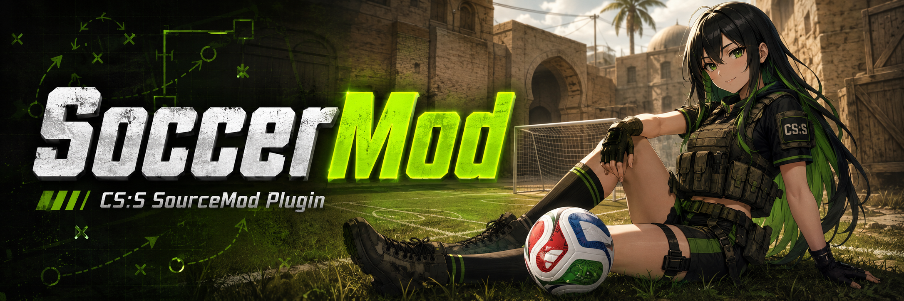

# Umbrella Soccer

Umbrella Soccer is a Counter-Strike: Source soccer plugin for SourceMod.

## Features

- Admin soccer menu with `!soccer`.
- Match control with selectable match time.
- Two-period match flow with halftime break, overtime support, and optional golden goal.
- Kickoff system with random first kickoff.
- Live scoreboard HUD and translated chat messages.
- Goal, assist, and own-goal announcements.
- Goalkeeper toggle with `!gk`.
- Stamina sprint using the normal walk/speed key.
- Captain draft mode with automatic pick menus.
- Referee tools for cards and score adjustment.
- Practice tools with training ball and training cannon.
- Default Umbrella Soccer player skins.
- Official training ball model.
- Official map included: `ka_soccer_world_cup_2026`.
- FastDL package included with compressed `models`, `materials`, and `maps`.

## Requirements

- Counter-Strike: Source server.
- Latest stable SourceMod release.

## Installation

1. Download `umbrella_soccer-1.0.0-server.zip`.
2. Extract it into the server `cstrike` folder.
3. Restart the server or change the map.
4. Open the admin menu with `!soccer`.

The server package includes:

- `addons/sourcemod/plugins/umbrella_soccer.smx`
- `addons/sourcemod/scripting/umbrella_soccer.sp`
- `addons/sourcemod/translations/umbrella_soccer.phrases.txt`
- `cfg/sourcemod/umbrella_soccer.cfg`
- `models`
- `materials`
- `maps/ka_soccer_world_cup_2026.bsp`

## FastDL

1. Download `umbrella_soccer-1.0.0-fastdl.zip`.
2. Extract it into the root folder used by your `sv_downloadurl`.
3. Make sure the web host exposes the extracted folders directly:

```text
materials/...
models/...
maps/ka_soccer_world_cup_2026.bsp.bz2
```

Do not serve the FastDL zip directly. The zip is only provided to make uploading easier.

## Main Commands

Player commands:

- `!gk` - toggle goalkeeper position.
- `!position` - show your current soccer position.

Admin commands:

- `!soccer` - open the Umbrella Soccer admin menu.
- `sm_soccer_start` - start a match.
- `sm_soccer_stop` - stop the current match.
- `sm_soccer_pause` - pause the current match.
- `sm_soccer_unpause` - resume the current match.
- `sm_soccer_score <ct> <t>` - set the match score.
- `sm_soccer_goal <ct/t>` - force a goal.

Most administration should be done from the `!soccer` menu.

## Configuration

The default config is included at:

```text
cfg/sourcemod/umbrella_soccer.cfg
```

Important cvars:

| Cvar | Default | Description |
| --- | ---: | --- |
| `sm_soccer_enabled` | `1` | Enables Umbrella Soccer. |
| `sm_soccer_allowed_maps` | `soccer_,ka_` | Allowed map names or prefixes. |
| `soccer_mod_match_period_length` | `3` | Match period length in minutes. |
| `soccer_mod_match_period_break_length` | `10` | Halftime break length in seconds. |
| `soccer_mod_match_periods` | `2` | Number of match periods. |
| `soccer_mod_match_overtime` | `1` | Enables overtime when regulation ends tied. |
| `soccer_mod_match_overtime_percent` | `25.0` | Overtime duration as percent of total match time. |
| `soccer_mod_match_golden_goal` | `0` | Enables golden goal only during overtime. |
| `sm_soccer_training_ball_model` | `models/ayrton09/fifa_trionda_2026/trionda_2026.mdl` | Training ball model. |

## Included Default Assets

Player models:

- `models/player/soccer2026/away/ct_urban.mdl`
- `models/player/soccer2026/gkaway/ct_urban.mdl`
- `models/player/soccer2026/home/ct_urban.mdl`
- `models/player/soccer2026/gkhome/ct_urban.mdl`

Ball model:

- `models/ayrton09/fifa_trionda_2026/trionda_2026.mdl`

Official map:

- `maps/ka_soccer_world_cup_2026.bsp`

## Notes

Some store/player-skin plugins can override soccer skins. If players keep their store skin instead of the soccer skin, unload or disable that skin system on soccer maps.
